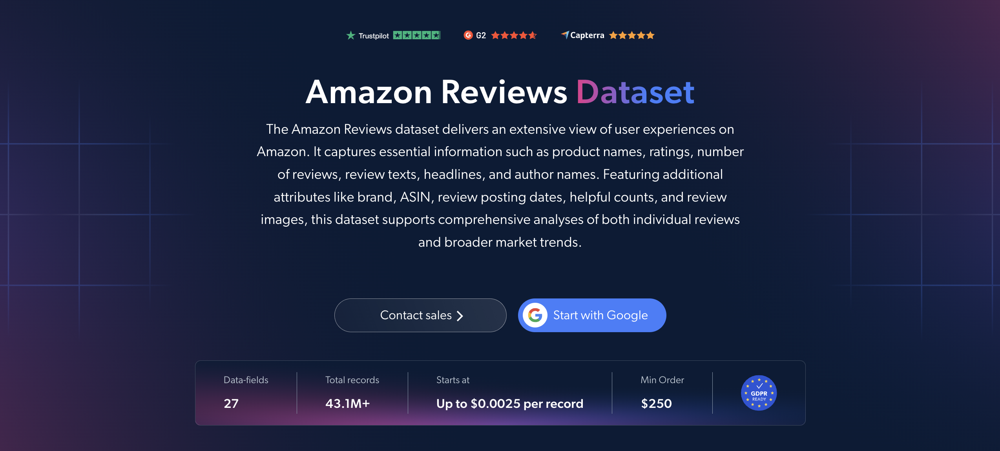

# Amazon 评论数据集样本

<h2>包含 1000 条 Amazon 评论的样本数据集</h2>

<a href="https://www.bright.cn/products/datasets/amazon/reviews">
   
</a>

包含 1000 条商品评论的 Amazon 评论数据集样本。该数据集使用 <b>Bright Data API</b> 提取。

<h2>数据集包含的部分数据点：</h2>

* ```url```：Amazon 上的评论 URL
* ```review_id```：每条评论的唯一标识符
* ```asin```：商品的 Amazon 标准识别码
* ```product_name```：商品名称
* ```brand```：商品品牌
* ```categories```：商品类别
* ```department```：商品所属部门
* ```product_rating```：商品平均评分
* ```product_rating_count```：商品评分总数
* ```product_rating_object```：商品各星级评分明细
* ```rating```：评论者给出的评分
* ```review_header```：评论标题
* ```review_text```：评论文本内容
* ```review_posted_date```：评论发布日期
* ```review_country```：评论对应的国家/地区
* ```author_name```：评论者姓名
* ```badge```：评论者的徽章或荣誉标识
* ```is_verified```：评论是否来自已验证购买
* ```is_amazon_vine```：评论是否属于 Amazon Vine 计划
* ```helpful_count```：认为该评论有帮助的用户数量
* ```variant_name```：被评论的商品变体，例如尺寸或颜色
* ```review_images```：评论所附图片
* ```videos```：评论所附视频

以及更多内容。

这是“Amazon 评论（公共数据）”数据集中的一个样本子集，完整数据集包含超过 <b>43,100,000 条评论</b>。

可用的数据集文件格式：<b>JSON、NDJSON、JSON Lines、CSV 或 Parquet。文件还可选择压缩为 .gz 格式</b>。

数据集交付方式选项：<b>电子邮件、API 下载、Webhook、Amazon S3、Google Cloud Storage、Google Cloud Pub/Sub、Microsoft Azure、Snowflake、SFTP</b>。

更新频率：<b>单次、每日、每周、每月、每季度、每半年或自定义周期</b>。

可在提取的数据点基础上增加数据丰富化服务：<b>按需提供。</b>

<b>[获取完整的 Amazon 评论数据集](https://www.bright.cn/products/datasets/amazon/reviews)</b>。

<a href="https://www.bright.cn/products/datasets/amazon/reviews">
</a>

<h2>Amazon 评论数据集有哪些使用场景？</h2>

<h3>1. 商品表现分析</h3>
企业使用 Amazon 评论数据集评估商品在客户中的表现。通过分析评论文本、评分和有帮助票数，公司可以了解客户满意度、常见问题和广受好评的功能，为商品改进和营销信息提供依据。

<h3>2. 客户行为洞察</h3>
品牌通过分析评论所在国家/地区、被评论的商品变体和已验证购买，了解客户偏好和购买模式。这些洞察有助于开展更个性化的营销、提供更准确的商品推荐，并更明智地决定重点推广哪些商品变体。

<h3>3. 评论真实性检查</h3>
分析人员将已验证购买评论和 Amazon Vine 评论与其他评论区分开来，并根据有帮助票数赋予相应权重。这样可以更可靠地评估商品质量，并在低价值反馈影响分析结果之前将其过滤掉。

<h2>为学术研究人员和非政府组织免费提供网页爬虫工具和数据集</h2>

Bright Initiative 为领先的高校院系和研究人员，以及致力于推动各类环境与社会事业的非政府组织和非营利组织，提供 Bright Data 的 <b>[网页爬虫工具 API](https://www.bright.cn/products/web-scraper)</b> 和 <b>[即用型数据集](https://www.bright.cn/products/datasets)</b>。你可以在<b>[此处](https://brightinitiative.com)</b>提交申请。
